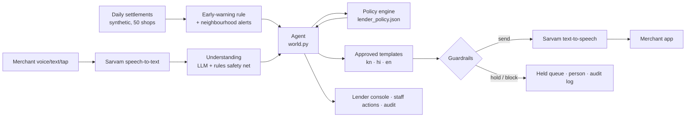

# Sambhal

**Repayment help for Paytm merchant loans, before the first missed payment, and ready for the next bad week.**
Paytm Build for India AI Hackathon, Bengaluru · Track 2: AI-Powered Financial Journeys · Team chill.out

Paytm merchant loans are repaid from the merchant's daily settlement. When a shop has a bad week, unpaid
installments carry forward and land in one large sweep, and the merchant's record shows days overdue.
Paytm sees settlements every day, so it can spot trouble days before a miss. Sambhal uses that:

1. **Detect.** After every evening settlement, a plain rule flags shops whose sales fell below half of their
   normal for two days running, or whose installment wasn't fully collected. When many shops in one area dip
   together, it raises one **neighbourhood alert** instead.
2. **Talk.** A voice and text message in the merchant's language (Kannada, Hindi, English), only between
   8 am and 7 pm, opening with a recording notice and naming the grievance officer.
3. **Fix.** The merchant replies in their own words, by voice, or with one tap. Sambhal understands the reason
   and offers only what the lender pre-approved (for example a 3-day pause repaid over 14 days). Code computes
   every rupee. Merchants can also **tell us first**, before a closure happens.
4. **Verify.** When sales recover, Sambhal confirms it and closes the case. If a paused shop turns out to be
   open, the pause ends early (**trust, then check**). Every step is in the lender's audit log.
5. **Prepare.** Sambhal offers **pay-ahead**: on good days a little goes towards future installments, so the next
   bad week is covered before it starts.

**The rule that runs through everything:** the AI listens and talks; code decides money, timing and what is allowed.

## Run it (2 minutes)

```bash
./run.sh                    # Mac/Linux: sets up Python 3.12 (with uv if installed), installs, tests, starts
run_windows.bat             # Windows
```

or by hand:

```bash
python -m venv .venv && source .venv/bin/activate        # Windows: .venv\Scripts\activate
pip install -r requirements.txt
cp .env.example .env                                      # add your Sarvam key (optional, see below)
python scripts/check_keys.py                              # live Sarvam voice + AI check
python scripts/warm_voice_cache.py                        # saves every demo line as audio, listens back to each
uvicorn app.main:app --port 8000
python scripts/check_mic.py                               # (app running) end-to-end voice check, then press Reset
```

`check_mic.py` plays three Kannada replies, in a different Sarvam voice, into the app as its microphone and presses
Sambhal's own mic button: browser recording → Sarvam speech-to-text → reader → reply. It caught two bugs the unit
tests couldn't: Sarvam rejected the browser's `audio/webm;codecs=opus` label (every recording failed), and with
hint words Sarvam "heard" the word ಕಂತು in silence, which the agent then acted on.

Needs Python 3.10+ (3.9 also works). Open http://localhost:8000. A welcome card explains the screen; **About**
reopens it. Press **Next ▶** (or the → key) to walk through the story. Each step opens the right screens and
briefly highlights what the caption talks about. **Big text** in the header is for projectors.

**No keys? It still runs.** Without keys Sambhal uses its multilingual rules reader, approved templates and the
browser's own voice. The page loads nothing from the internet (fonts are bundled). With `OFFLINE=1` (or the
**Offline** switch) it never touches the network, which is the fallback if venue wifi fails. Audio saved by
`warm_voice_cache.py` still plays offline.

## The screen

**Left: the merchant's app** (in their language, English underneath with **EN**):

* **Home:** last settlement, next deduction, pay-ahead, and three big buttons: *tell us about a closure* (pick a
  reason and dates), *ask about my loan*, *talk to a person*. **Sambhal's promise** opens six promises, read aloud,
  with the switch to turn Sambhal's messages off (consent can be withdrawn any time).
* **Messages:** voice notes, one-tap reasons, a large mic button, offers with a day-by-day preview and a big Accept.
* **My loan:** balance, a 14-day deduction calendar (paid, paused, catch-up, paid from pay-ahead), the new-loan check.

The shortcuts under the phone are for the presenter, not part of the app.

**Right: the lender's console:** cases with timelines, the guardrail results on every message, how each reply was
read, staff actions for cases with a person, neighbourhood alerts, the with/without comparison, the Proof tab, the
lender what-if and the audit log.

## The demo (presenter mode)

| Step | Simulated time | What happens |
|---|---|---|
| 0 | Wed 21 Oct, 10:00 | Ravi: kirana in Basavanagudi, ₹1,36,000 loan, ₹850 a day, 71 installments without a miss |
| 1 | Wed 9:05 pm | Sales 48% of normal. One slow day: Sambhal only watches |
| 2 | Thu 9:05 pm | Second day below half (31%). Case opened. 9 pm is outside 8 am–7 pm, so the message is **held** |
| 3 | Fri 8:00 am | Check-in in Kannada, voice and text, recording notice, grievance officer |
| 4 | Fri 8:20 am | Ravi replies by voice: *ಮನೆಯಲ್ಲಿ ಮದುವೆ ಇದೆ, ಭಾನುವಾರದವರೆಗೆ ಅಂಗಡಿ ಮುಚ್ಚಿರುತ್ತೆ* (wedding at home, shop shut till Sunday). Sambhal offers the lender's 3-day pause |
| 5 | Fri 8:22 am | Ravi taps Accept. The pause is written to the deduction calendar. Quiet until Monday (family function) |
| 6 | Sun 9:05 pm | Shop shut. No deduction, nothing overdue, no messages |
| 7 | Mon 9:05 pm | ₹1,032 deducted (17% of sales). **Without Sambhal: ₹3,400 (57%) after 3 days overdue** |
| 8 | Tue 8:00 am | Recovery confirmed, case closed. The message offers pay-ahead |
| 9 | Tue 8:10 am | **Prepare:** Ravi turns on pay-ahead (₹100 on days he sells ₹6,000 or more). Had it been on from the start, ₹3,800 paid ahead would have covered the wedding by itself: no pause, no catch-up, nothing overdue |
| 10 | Tue 11:00 am | *Beyond Ravi:* **Shobha tells us first** about her sister's wedding (Fri–Sun); the pause is booked for those days |
| 11 | Wed 28 Oct, 9:05 pm | *Beyond Ravi:* **Bellandur**: 8 shops at 25% of normal, the rest of the city normal. One neighbourhood alert, no check-ins |
| 12 | Thu 10:00 am | *Beyond Ravi:* the lender approves **one area pause** for all 8 shops |
| 13 | Sun 1 Nov, 9:05 pm | *Beyond Ravi:* **trust, then check**: Shobha's shop was open on Sunday, so the pause ends early and her catch-up shrinks |

Steps 10–13 are optional (dashed dots). At step 4 you can speak into the mic instead (Sarvam speech-to-text), type
any reply, or tap a reason.

While the story runs, 49 other synthetic merchants live through the same weeks. The lender console shows what
Sambhal did for each, including the cases where it **refused to act**:

| Merchant | What happens | Why |
|---|---|---|
| Lakshmi (Kannada) | Father passed away → all reminders stopped, handed to a person (staff can approve 7 days; no calls) | Bereavement |
| Imran (Hindi) | Sales at 11% but says "all fine" → review, no relief | Possible payments to another QR |
| Suresh (Kannada) | Son in ICU → handed to a person | Medical emergency |
| Pooja (Hindi) | Rain and road works → half installment for 14 days | Lender's menu |
| Venkatesh (Kannada) | Shop under repair → not eligible, goes to a person | Already had a pause in September |
| Farhan (Hindi) | Asks to waive interest → declined kindly, offered only the menu | Agent can't change terms |
| Meena (English) | No messaging consent → nothing sent, a person calls | Consent |
| Arjun (English) | "You deducted twice" → grievance officer, reminders paused | Dispute |
| Shobha (Kannada) | Tells us first; reopens a day early → pause shortened | Tell us first · trust, then check |
| 8 shops in Bellandur | Dip together → one alert, no check-ins, one area pause | Neighbourhood alert |

## Proof tab

* **Sambhal's promise, proven.** Each of the six promises names the rule that enforces it and the scenario checks
  and tests that prove it; they turn green as the checks pass.
* **40 scenario checks** (`data/scenarios.json`): contact hours, repeated contact, disclosure, sensitive
  situations in three languages, eligibility, exact maths, consent, fraud signals, the AI message check, early
  warning, the right-sizer. Each builds a fresh world and checks the outcome. Also run by `pytest`.
* **Replay, 50 merchants, with vs without.** Same synthetic sales, 21 Oct – 10 Nov:

  | | With Sambhal | Without | Pay-ahead only* |
  |---|---|---|---|
  | Merchants who fell overdue | 5 | 22 | 1 |
  | Merchant-days overdue | 32 | 66 | 1 |
  | Merchants 3+ days overdue | 5 | 13 | 0 |
  | Biggest single deduction (median, × normal installment) | 1.2× | 2.0× | 1.0× |
  | Guardrail violations found by an independent audit | 0 of 73 messages | | |

  29 of 50 merchants were flagged. The 5 still overdue are all with a person by design (bereavement, ICU, review,
  grievance, not eligible) and are counted with no relief. Area alerts assume the lender approves the area pause
  the next morning. *Pay-ahead only: the plain loan with the merchant's own pay-ahead on since the loan began and
  no other help; it assumes every merchant opts in, so it is an upper bound to test in a pilot, not a forecast.
  Synthetic data: this shows how a pilot would be measured, not a real result.

## Lender what-if

Change the relief menu (pause length, catch-up days, slow-business share, eligibility) and replay the same 50
merchants before it goes live. Examples from the synthetic data: pausing up to 2 days instead of 3 leaves
**13 merchants overdue instead of 5**; repaying over 7 days instead of 14 makes the heaviest day 1.43× a normal
installment instead of 1.21×. Only a small set of safe values can be chosen, and the live demo keeps using the
file's menu.

## How it's built



| File | Role |
|---|---|
| `app/data.py` | Synthetic merchants, loans, 5½ months of daily sales (fixed seed) |
| `app/ledger.py` | Daily-deduction mechanics: arrears carry forward, days overdue, pay-ahead |
| `app/signals.py` | Early-warning rule (amber: 2 days < 50% of normal; red: something overdue) |
| `app/policy.py` + `data/lender_policy.json` | Lender's relief menu, eligibility, exact terms, pay-ahead settings, what-if |
| `app/guardrails.py` | Contact hours, consent, quiet periods, frequency caps, borrower-only, the AI message check |
| `app/nlu.py` | Reads replies: LLM when configured, multilingual rules always (rules can only escalate; day counts and "yes" come from code) |
| `app/replies.py` | Approved message templates, one-tap replies and Sambhal's promise in Kannada, Hindi, English |
| `app/world.py` | Simulated clock, cases, the agent's decisions, neighbourhood alerts, staff actions |
| `app/voice.py` | Sarvam speech-to-text (`saaras:v4`) and text-to-speech (`bulbul:v3`) with an audio cache |
| `app/sizer.py` | Loan right-sizer: tests the installment against the merchant's own slowest weeks |
| `app/evals.py`, `app/replay.py` | Scenario suite; with/without replay, independent audit, what-if |
| `app/presenter.py` | The presenter steps |

### Guardrails (all in code, all tested)

| Rule | What Sambhal does | Source |
|---|---|---|
| Contact hours | Proactive messages only 8 am–7 pm; outside, held until 8 am. Replies allowed within 30 min of the merchant writing | RBI recovery directions, 6 Aug 2026 (in force 1 Jan 2027) |
| Disclosure | Every message opens with a recording notice and names the grievance officer | Same |
| No repeated contact | At most 1 proactive message a day, 3 a week | Same: no harassment or repeated calling |
| Sensitive situations | Bereavement or medical emergency: stop everything for 14 days, hand to a person; staff can't call either. Family function: quiet until it ends | Same: avoid contact at such times |
| Local event | Many shops in one area down together: no reminders there until sales recover; one lender decision | Same: no contact during calamities |
| Lender's menu only | Offers come from `lender_policy.json`; waivers, longer pauses and other terms go to staff | Our design |
| Accepting changes the loan | A reply with a question, "not" or "but" never counts as yes | Our design |
| Consent | No proactive messages without opt-in; the merchant can switch Sambhal off or on in the app | DPDP Act |
| Borrower only | Never contacts anyone but the borrower | RBI: no third-party pressure |
| Dispute | Routes to the grievance officer; reminders paused | Our design |
| Possible diversion | Sales collapse + "all fine" → review, no relief | Our design |
| Trust, then check | Normal sales on a paused day: that day is collected as usual, the rest of the pause is cancelled | Our design |
| AI message check | If the LLM rephrases a message: same numbers only, merchant's script, no threats or third parties, else the template is sent | Our design |

### Pay-ahead, carefully

Pay-ahead is the merchant's choice and can be switched off any time. On a day when sales reach their usual day's
level and nothing is owed, a small amount (about an eighth of the installment) is paid towards future
installments; on a short day it pays first. It is **installments paid early to the lender, not a deposit or a
wallet** (and not with Paytm Payments Bank, which can't take deposits). The merchant pays the same total, just
earlier, on days when it hurts least. A lender would need to confirm there is no charge for paying early.

### What's real and what's simulated

| Real (running code) | Simulated |
|---|---|
| Early-warning rule, neighbourhood alerts, policy engine, ledger maths, pay-ahead, guardrails, audit | Merchants, loans and sales (synthetic) |
| Sarvam speech-to-text and text-to-speech (tested live with a key on 29 Oct) | Paytm settlement feed and lender systems |
| Sarvam LLM understanding of free-form replies (tested live), rules reader always | Merchant replies for the background shops |
| 40 scenario checks, 156 tests, with/without replay, what-if | Lender staff decisions in the replay; delivery channel (shown as an app, not WhatsApp/SMS) |

## Configuration (`.env`)

| Variable | Default | Notes |
|---|---|---|
| `SARVAM_API_KEY` | – | Voice, and the default LLM |
| `LLM_PROVIDER` | `sarvam` if a Sarvam key is set | `sarvam` · `openai` (any OpenAI-compatible URL, e.g. Gemini or Groq) · `anthropic` · `none` |
| `LLM_API_KEY`, `LLM_MODEL`, `LLM_BASE_URL` | per provider | Sarvam: `sarvam-105b`, `https://api.sarvam.ai/v1` |
| `LLM_REASONING_EFFORT` | `none` for Sarvam | `none` turns off the model's thinking step: replies in ~0.5 s. With `low`, sarvam-105b thought for ~1,450 tokens (6–9 s) and sometimes ran out before answering |
| `LLM_TIMEOUT` | `8` | Seconds before the rules reader answers instead |
| `LLM_REWRITE` | `0` | `1` lets the LLM rephrase approved messages (each is checked). Off keeps the stage demo deterministic and the voice cache valid |
| `TTS_SPEAKER` | `priya` | Any `bulbul:v3` speaker (lowercase) |
| `OFFLINE` | `0` | `1` = rules, templates and cached audio only |

Only live input (typed or spoken) goes to the LLM; the background shops' scripted lines are read by the rules, so
stepping through the week never waits on the network.

## Tests

```bash
pytest -q                       # 156 tests: all 40 scenarios, the story, replay, readers, reply safety, pay-ahead,
                                #   tell us first, neighbourhood alert, staff actions, what-if, promises, server start,
                                #   mocked LLM and Sarvam (tests never touch the network)
python scripts/run_evals.py     # human-readable report
```

## Troubleshooting

* **No sound:** run `python scripts/check_keys.py`. Without a Sarvam key the browser's own voice is used (macOS has
  Kannada and Hindi voices, but they sound robotic).
* **Mic does nothing:** the browser needs microphone permission for `localhost`. Use Chrome. Then run
  `python scripts/check_mic.py` with the app running: it tests the whole voice path without anyone speaking.
* **LLM slow on stage:** set `OFFLINE=1` or flip the Offline switch. The rules reader handles all demo lines.
* **Port busy:** `uvicorn app.main:app --port 8010`.
* **Sarvam out of credits** (`402 No credits available`): the app switches itself to saved audio, the browser's
  speech recognition and the rules reader, and the header says so. Top up on the Sarvam dashboard, then run
  `python scripts/warm_voice_cache.py --story` (only the 28 lines the presenter can play, about ₹30) or
  `--remake kn,en` for all 98 lines (about ₹100–165), listening back included. Background shops without saved
  audio use the browser's voice.

### How Sambhal's voice is checked

A Wispr Flow listening test (Sambhal's audio played aloud, Wispr transcribing) and then Sarvam's own speech-to-text
on the clean files found three faults: the Kannada voice dropped "fifty" from amounts (₹850 spoken as 800,
₹2,550 as 2,500) and said "rupees" in English; long Hindi lines were cut off before the end; and "सब ठीक है?"
sounded like a statement ("everything is fine"). Now the voice is given amounts in Kannada words with ರೂಪಾಯಿ
(the screen still shows ₹850), long lines are spoken a sentence at a time, Hindi questions say क्या, and
`warm_voice_cache.py` plays every saved line back through speech-to-text and remakes any whose amount or ending
isn't heard (up to 3 times).

## Built before vs on the day

The organisers confirmed that code written before the event is allowed. This repository was built before
31 October 2026. Work done on the day is listed in `CHANGELOG.md`.

*Prototype. All merchants, loans, sales and the lender ("Demo NBFC") are fictional. Not affiliated with any lender.*
