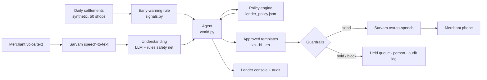

# Sambhal

**Repayment help for Paytm merchant loans, before the first missed payment.**
Paytm Build for India AI Hackathon, Bengaluru · Track 2: AI-Powered Financial Journeys · Team chill.out

Paytm merchant loans are repaid from the merchant's daily settlement. When a shop has a bad week, unpaid
installments carry forward and land in one large sweep, and the merchant's record shows days overdue.
Paytm sees settlements every day, so it can spot trouble days before a miss. Sambhal uses that:

1. **Watch.** After every evening settlement, a plain rule flags shops whose sales fell below half of their
   normal for two days running, or whose installment wasn't fully collected.
2. **Talk.** A voice and text message in the merchant's language (Kannada, Hindi, English), only between
   8 am and 7 pm, opening with a recording notice and naming the grievance officer.
3. **Fix.** The merchant replies in their own words. Sambhal understands the reason and offers only what the
   lender pre-approved (for example a 3-day pause repaid over 14 days). Code computes every rupee.
4. **Verify.** When sales recover, Sambhal confirms it and closes the case, with an audit trail for the lender.

**The rule that runs through everything:** the AI listens and talks; code decides money, timing and what is allowed.

## Run it (2 minutes)

```bash
python -m venv .venv && source .venv/bin/activate        # Windows: .venv\Scripts\activate
pip install -r requirements.txt
cp .env.example .env                                      # add your keys (optional, see below)
python scripts/check_keys.py                              # checks Sarvam + LLM, if keys are set
python scripts/warm_voice_cache.py                        # caches all demo audio (needs Sarvam key)
uvicorn app.main:app --port 8000
```

Needs Python 3.10+ (3.9 also works). `run.sh` uses [uv](https://docs.astral.sh/uv/) to set up Python 3.12 if you have it.

Open http://localhost:8000 and press **Next ▶** (or the → key) to walk through Ravi's week.
`./run.sh` (Mac/Linux) or `run_windows.bat` do the install and start in one step.

**No keys? It still runs.** Without keys Sambhal uses its multilingual rules reader, approved templates and
the browser's own voice. Fonts are bundled, so the page itself needs no internet. With `OFFLINE=1` (or the Offline switch in the header) it
never touches the network,
which is the fallback if venue wifi fails. Audio cached by `warm_voice_cache.py` still plays offline.

## The demo: Ravi's week (presenter mode)

| Step | Simulated time | What happens |
|---|---|---|
| 0 | Wed 21 Oct, 10:00 | Ravi: kirana in Basavanagudi, ₹1,36,000 loan, ₹850 a day, 71 installments without a miss |
| 1 | Wed 9:05 pm | Sales 48% of normal. One slow day: Sambhal only watches |
| 2 | Thu 9:05 pm | Second day below half (31%). Case opened. 9 pm is outside 8 am–7 pm, so the message is **held** |
| 3 | Fri 8:00 am | Check-in in Kannada, voice and text, recording notice, grievance officer |
| 4 | Fri 8:20 am | Ravi replies by voice: *ಮನೆಯಲ್ಲಿ ಮದುವೆ ಇದೆ, ಭಾನುವಾರದವರೆಗೆ ಅಂಗಡಿ ಮುಚ್ಚಿರುತ್ತೆ* (wedding at home, shop shut till Sunday). Sambhal offers the lender's 3-day pause |
| 5 | Fri 8:22 am | Ravi taps Accept. The pause is written to the deduction calendar. Quiet until Monday (family function) |
| 6 | Sun 9:05 pm | Shop shut. No deduction, nothing overdue, no messages |
| 7 | Mon 9:05 pm | ₹1,032 deducted (17% of sales). **Without Sambhal: ₹3,400 (57%) after 3 days overdue** |
| 8 | Tue 8:00 am | Recovery confirmed, case closed |

At step 4 you can speak into the mic instead (Sarvam speech-to-text), or type any reply. The quick-reply chips
let you show judges other paths live: a waiver request, slow business, a bereavement.

While Ravi's story runs, 49 other synthetic merchants live through the same week. The lender console shows
what Sambhal did for each, including the cases where it **refused to act**:

| Merchant | What happens | Why |
|---|---|---|
| Lakshmi (Kannada) | Father passed away → all reminders stopped, handed to a person | Bereavement |
| Imran (Hindi) | Sales at 11% but says "all fine" → review, no relief | Possible payments to another QR |
| Suresh (Kannada) | Son in ICU → handed to a person | Medical emergency |
| Pooja (Hindi) | Rain and road works → half installment for 14 days | Lender's menu |
| Venkatesh (Kannada) | Shop under repair → not eligible, goes to a person | Already had a pause in September |
| Farhan (Hindi) | Asks to waive interest → declined kindly, offered only the menu | Agent can't change terms |
| Meena (English) | No messaging consent → nothing sent, a person calls | Consent |
| Arjun (English) | "You deducted twice" → grievance officer, reminders paused | Dispute |

## Proof tab

* **40 scenario checks** (`data/scenarios.json`): contact hours, repeated contact, disclosure, sensitive
  situations in three languages, eligibility, exact maths, consent, fraud signals, the AI message check, early
  warning, the right-sizer. Each builds a fresh world and checks the outcome. Also run by `pytest`.
* **Replay, 50 merchants, with vs without.** Same synthetic sales, 21 Oct – 10 Nov, through the plain loan and
  through Sambhal:

  | | With Sambhal | Without |
  |---|---|---|
  | Merchants who fell overdue | 5 | 14 |
  | Merchant-days overdue | 32 | 59 |
  | Biggest single deduction (median, × normal installment) | 1.2× | 4.0× |
  | Guardrail violations found by an independent audit | 0 of 74 messages | |

  The 5 still overdue are all with a person by design (bereavement, ICU, review, grievance, not eligible), and
  are counted with no relief. Synthetic data: this shows how a pilot would be measured, not a real result.

## How it's built



| File | Role |
|---|---|
| `app/data.py` | Synthetic merchants, loans, 5½ months of daily sales (fixed seed) |
| `app/ledger.py` | Daily-deduction mechanics: arrears carry forward, days overdue |
| `app/signals.py` | Early-warning rule (amber: 2 days < 50% of normal; red: something overdue) |
| `app/policy.py` + `data/lender_policy.json` | Lender's relief menu, eligibility, exact terms |
| `app/guardrails.py` | Contact hours, consent, quiet periods, frequency caps, borrower-only, the AI message check |
| `app/nlu.py` | Reads replies: LLM when configured, multilingual rules always (rules can only escalate) |
| `app/replies.py` | Approved message templates in Kannada, Hindi, English |
| `app/world.py` | Simulated clock, cases, the agent's decisions |
| `app/voice.py` | Sarvam speech-to-text (`saaras:v4`) and text-to-speech (`bulbul:v3`) with an audio cache |
| `app/sizer.py` | Loan right-sizer: tests the installment against the merchant's own slowest weeks |
| `app/evals.py`, `app/replay.py` | Scenario suite; with/without replay and independent audit |
| `app/presenter.py` | The nine demo steps |

### Guardrails (all in code, all tested)

| Rule | What Sambhal does | Source |
|---|---|---|
| Contact hours | Proactive messages only 8 am–7 pm; outside, held until 8 am. Replies allowed within 30 min of the merchant writing | RBI recovery directions, 6 Aug 2026 (in force 1 Jan 2027) |
| Disclosure | Every message opens with a recording notice and names the grievance officer | Same |
| No repeated contact | At most 1 proactive message a day, 3 a week | Same: no harassment or repeated calling |
| Sensitive situations | Bereavement or medical emergency: stop everything for 14 days, hand to a person. Family function: quiet until it ends | Same: avoid contact at such times |
| Lender's menu only | Offers come from `lender_policy.json`; waivers and other terms go to staff | Our design |
| Consent | No proactive messages without opt-in at loan sign-up | DPDP Act |
| Borrower only | Never contacts anyone but the borrower | RBI: no third-party pressure |
| Dispute | Routes to the grievance officer; reminders paused | Our design |
| Possible diversion | Sales collapse + "all fine" → review, no relief | Our design |
| AI message check | If the LLM rephrases a message: same numbers only, merchant's script, no threats or third parties, else the template is sent | Our design |

### What's real and what's simulated

| Real (running code) | Simulated |
|---|---|
| Early-warning rule, policy engine, ledger maths, guardrails, audit | Merchants, loans and sales (synthetic) |
| Sarvam speech-to-text and text-to-speech (with your key) | Paytm settlement feed and lender systems |
| LLM understanding of free-form replies (with your key), rules reader always | Merchant replies for the 49 background shops |
| 40 scenario checks, 80 tests, with/without replay | Delivery channel (shown as a phone, not WhatsApp/SMS) |

## Configuration (`.env`)

| Variable | Default | Notes |
|---|---|---|
| `SARVAM_API_KEY` | – | Voice, and the default LLM |
| `LLM_PROVIDER` | `sarvam` if a Sarvam key is set | `sarvam` · `openai` (any OpenAI-compatible URL, e.g. Gemini or Groq) · `anthropic` · `none` |
| `LLM_API_KEY`, `LLM_MODEL`, `LLM_BASE_URL` | per provider | Sarvam: `sarvam-105b`, `https://api.sarvam.ai/v1` |
| `LLM_REWRITE` | `0` | `1` lets the LLM rephrase approved messages (each is checked). Off keeps the stage demo deterministic and the voice cache valid |
| `TTS_SPEAKER` | `priya` | Any `bulbul:v3` speaker (lowercase) |
| `OFFLINE` | `0` | `1` = rules, templates and cached audio only |

## Tests

```bash
pytest -q                       # 80 tests: all 40 scenarios + story, replay, readers, reply safety, server start,
                                #           mocked LLM and Sarvam
python scripts/run_evals.py     # human-readable report
```

## Troubleshooting

* **No sound:** run `python scripts/check_keys.py`. Without a Sarvam key the browser's own voice is used, and
  many browsers have no Kannada voice.
* **Mic does nothing:** the browser needs microphone permission for `localhost`. Use Chrome.
* **LLM slow on stage:** set `OFFLINE=1` or flip the Offline switch. The rules reader handles all demo lines.
* **Port busy:** `uvicorn app.main:app --port 8010`.

## Built before vs on the day

The organisers confirmed that code written before the event is allowed. This repository was built before
31 October 2026. Work done on the day is listed in `CHANGELOG.md`.

*Prototype. All merchants, loans, sales and the lender ("Demo NBFC") are fictional. Not affiliated with any lender.*
